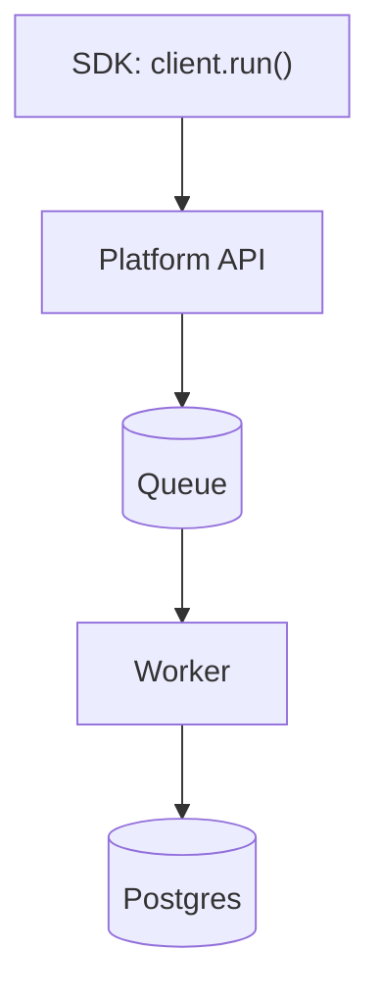

# Blog playbook

The steps to follow every time a post is written or updated. Posts live in Sanity
(project `rzj1f3b0`, dataset `production`) and render at `/blog/<slug>`.

> The drafting kit (`.tmp/blog/`) is local and git-ignored. If it is missing, ask
> for it to be restored before starting, or edit the post directly in Studio
> (`/studio`) following the same rules below.

---

## 1. Plan the post

- [ ] One idea per post. Write the one-sentence takeaway before anything else.
- [ ] Pick the slug: lowercase, hyphenated, no dates (e.g. `why-replay-needs-the-checkpoint`).
- [ ] Decide the visuals up front (see step 3). Every post needs at least one.
- [ ] Check the product repo (`../linea`) for anything you describe. Names, limits,
      and behaviour must match the real code, not what we think it does.

## 2. Write the draft

Create `.tmp/blog/posts/<slug>/post.md`:

```md
---
title: Why replay needs the checkpoint
excerpt: One or two sentences, max 200 characters. Used as the meta description.
tags: Runtime, Replay
---

Opening paragraph that states the problem plainly.

## A section heading
...
```

Writing rules:

- [ ] **No em dashes, en dashes, or ` -- `.** Use a full stop, comma, or colon. The check fails otherwise.
- [ ] Aim for 700 to 1,200 words. Short paragraphs, 2 to 4 sentences.
- [ ] Use `##` for sections and `###` sparingly. No `#` (the title is the h1).
- [ ] Concrete over abstract: real node names, real numbers, real failure cases.
- [ ] Code samples must run. Use a `switch` block when showing both SDKs:

  ````md
  ```switch
  --- typescript
  const run = await client.run("support-triage", { input });
  --- python
  run = client.run("support-triage", input=input)
  ```
  ````

  Never leave one language tab empty.
- [ ] End with a short takeaway or next step, not a sales pitch.

Supported markdown: paragraphs, `##`/`###`, `>` quotes, `-` and `1.` lists,
`---` dividers, fenced code, `switch` blocks, tables, `**bold**`, `*italic*`,
`` `code` ``, and `[links](https://...)`.

## 3. Add visuals

Pick the right tool for each visual:

| Visual | Use |
| --- | --- |
| Architecture, request paths, sequences, state machines | Mermaid block |
| Builder-style node graphs, run timelines, failure/replay states | Diagram kit PNG |
| The real product UI | Product screenshot |

Every image needs alt text that describes what it shows, not "diagram".

### Mermaid (architecture and flows)

````md

````

- [ ] First line is `%% caption: ...` (required).
- [ ] Prefer `flowchart LR`, so the diagram uses the page width and stays short. Use `TB` only for a stack of about four nodes.
- [ ] Max ~10 nodes, labels of 4 words or fewer, at most 2 Mermaid diagrams per post.
- [ ] Node classes (no `classDef` needed): `:::ai`, `:::integration`, `:::logic`,
      `:::data`, `:::sky` (highlight), `:::fail` (failure), `:::muted` (de-emphasised).
- [ ] Preview the source at [mermaid.live](https://mermaid.live) before publishing.

### Diagram kit (node graphs and runs)

1. Copy `.tmp/blog/kit/sample.mjs` to `.tmp/blog/posts/<slug>/diagrams/<name>.mjs`
   and fix the import path to `../../../kit/diagram.mjs`.
2. Build with `node`, `edge`, `infra`, `region`, `tag`, `codeCard` from the kit.
   Nodes match the product builder: set `kind` (`ai`, `integration`, `logic`,
   `data`, `trigger`) and an `icon` from `kit/icons.mjs`.
3. Pick a `theme`: `canvas` (plain dark panel) or `sky`, `mist`, `floor` (solid
   colour frame). Vary themes across a post. No gradients or glows.
4. Render:

   ```sh
   node .tmp/blog/kit/render.mjs .tmp/blog/posts/<slug>/diagrams/<name>.mjs
   ```

5. Open the PNG and check: no clipped text, edges meet ports (y + h/2 for
   single-row nodes, y + 20 for nodes with a `sub` row), nothing overlaps.
6. Reference it: ``.

### Product screenshots

``. Available: `builder`,
`dashboard`, `evals`, `signals`, `workflow` (from `public/linea/`).

## 4. Check

```sh
node --env-file=.env.local .tmp/blog/kit/publish.mjs check <slug>
```

- [ ] Prints `ok` (no dashes, excerpt ≤ 200 chars, all images have alt text and exist,
      every Mermaid block has a caption).
- [ ] Read the whole post out loud once. Cut anything that repeats.

## 5. Make sure the post exists in Sanity

The publish script **updates** an existing document with the ID `post-<slug>`.
It does not create posts.

- [ ] Existing post: nothing to do.
- [ ] New post: create the document with ID `post-<slug>` first, with title, slug,
      date, author, and hero image set. Documents created through the Studio UI
      get random IDs and will not be found by the script.
- [ ] Hero image: a product screenshot at **1627 x 967**. It is required.

## 6. Publish (needs approval)

Publishing writes to **production** Sanity. Get an explicit go-ahead first.

```sh
node --env-file=.env.local .tmp/blog/kit/publish.mjs publish <slug>
```

- [ ] The script backs up each document to `.tmp/blog/backup/post-<slug>.json`
      before patching. Keep the backup until the post is verified.
- [ ] It uploads images (deduplicated) and sets body, excerpt, and title/tags if
      given in front matter.
- [ ] Never print or paste `SANITY_WRITE_TOKEN` or any other value from `.env.local`.

## 7. Verify on the site

The blog revalidates every 60 seconds.

- [ ] `pnpm dev`, then open `http://localhost:3000/blog/<slug>` (use `localhost`, not `127.0.0.1`).
- [ ] Desktop and a 390px mobile width: images load, Mermaid diagrams render and
      scroll sideways if wide, code switcher tabs both work, tables fit.
- [ ] The post appears on `/blog` and in the home page blog section with the right
      excerpt and hero.

## Rolling back

Restore the backup with the Sanity client, or paste the backed-up `body` back in
Studio. Backups are in `.tmp/blog/backup/`.
